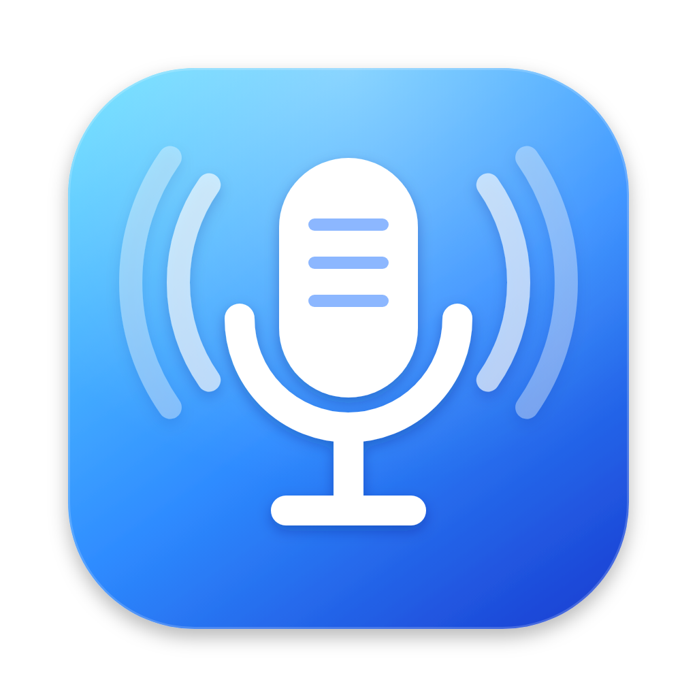

<p align="center"></p>

<h1 align="center">Dictate</h1>

<p align="center">Push-to-talk dictation for macOS that never leaves your Mac.</p>

Press **⌘L**, speak, press **⌘L** again — Dictate transcribes your speech locally with [whisper.cpp](https://github.com/ggml-org/whisper.cpp) and types the text wherever your cursor is. **Esc** cancels a recording.

- **Offline.** No network code in the app: audio and text never leave your Mac.
- **Small.** One Swift file, no Xcode project, no third-party Swift packages. Lives in the menu bar.
- **Your choice of model.** Three recommended Whisper models, or any `ggml-*.bin` file you already have.
- **Any language Whisper knows**, with auto-detection, plus an optional prompt to teach it your names and terms.

## Install

1. Download `Dictate-<version>-arm64.dmg` from [Releases](../../releases) (Apple Silicon, macOS 14 or later).
2. Open it and drag **Dictate** to **Applications**.
3. Open Dictate. macOS will refuse the first time because the app isn't notarized by Apple: open **System Settings → Privacy & Security**, scroll down and click **Open Anyway** next to Dictate.
4. Allow **Microphone** access when asked, then enable Dictate in **System Settings → Privacy & Security → Accessibility** (needed to paste the text for you). Quit Dictate from its menu bar icon and open it again.
5. Settings open on first launch: pick a model (see below) and click **Save**.
6. Put the cursor in any text field, press ⌘L, say something, press ⌘L.

> Building from source works on Intel Macs too — see [Build from source](#build-from-source).

## Models

Dictate doesn't download anything itself. **Download…** opens the file in your browser; when it finishes, click **Choose…** and pick it. Dictate checks the file against the official checksum and keeps a copy in `~/Library/Application Support/Dictate`, so you can delete the download.

| Model | Size | Notes |
|---|---|---|
| **Large v3 Turbo** | 1.6 GB | Recommended. Nearly Large v3 accuracy, several times faster. A good fit for a MacBook Air. |
| Large v3 | 3.1 GB | Most accurate and slowest. |
| Large v3 Turbo Q5 | 574 MB | Smallest and fastest, slightly less accurate. |

**Other file…** accepts any whisper.cpp model (`ggml-*.bin`), for example one already downloaded by [OpenWhispr](https://github.com/OpenWhispr/openwhispr) (Dictate finds those automatically). Only use model files from sources you trust: whisper.cpp parses them.

## Usage and settings

| Action | |
|---|---|
| Start / stop dictation | **⌘L** (change in Settings) |
| Cancel the recording | **Esc** while recording |
| Settings | menu bar icon → **Settings…** |

Settings:

- **Speech model** — one of the three presets or your own file.
- **Language** — Auto-detect, or fix it to one language for better accuracy.
- **Prompt** — an optional sample sentence in your style. Whisper imitates its language, names, spelling and punctuation. Example: `Open a pull request on GitHub and run the Spark job.`
- **Hotkey** — typed as text: `Cmd+L`, `Ctrl+Opt+Space`, `Cmd+Shift+D`, `F5`.

Reset all settings: `defaults delete io.github.vshankmute.dictate`

## Privacy and security

- The app contains no networking APIs. You can check a build yourself (empty output = good):
  `nm -u /Applications/Dictate.app/Contents/MacOS/* | grep -E '^_(socket|connect|getaddrinfo)$'`
  `make-dmg.sh` runs the same check and refuses to package if anything is found.
- The bundled `whisper-cli` is built from the pinned whisper.cpp release `v1.9.5` with the network backend (RPC) and libcurl disabled.
- Dictate starts `whisper-cli` with a clean environment and from `/`, so no extra libraries can be injected into it through environment variables or the working directory.
- The recording is kept in a temporary file only until it's transcribed (or cancelled) and then deleted.
- Transcribed text goes to the clipboard marked "this Mac only", so Universal Clipboard doesn't send it to your other devices.
- For an OS-level guarantee, block Dictate in a firewall such as [LuLu](https://objective-see.org/products/lulu.html); it will keep working.

## Troubleshooting

| Problem | Fix |
|---|---|
| "Dictate can't be opened" / "Apple could not verify…" | System Settings → Privacy & Security → **Open Anyway**. Or in Terminal: `xattr -dr com.apple.quarantine /Applications/Dictate.app` |
| Text isn't pasted automatically | Enable Dictate in Privacy & Security → Accessibility. After updating Dictate, remove it there (−) and add it again. |
| The hotkey does nothing | Another app uses it: choose a different one in Settings. |
| Transcription is slow | Try Large v3 Turbo or Large v3 Turbo Q5. The first transcription after launch is slower: Metal compiles its shaders. |
| `open` fails with error `-10825` (source build) | Rebuild with the current `build.sh`, which sets the deployment target. |
| `rm: … Operation not permitted` while rebuilding | System Settings → Privacy & Security → App Management → enable Terminal. |

## Build from source

Requirements: macOS 14+, Command Line Tools (`xcode-select --install`), [Homebrew](https://brew.sh).

```sh
git clone https://github.com/vshankmute/dictate.git
cd dictate
brew install whisper.cpp
brew pin whisper.cpp ggml libomp      # keep the reviewed versions
bash build.sh && open Dictate.app
```

A source build uses `whisper-cli` from Homebrew (or from `~/Library/Application Support/Dictate/whisper-cli`). Models can be fetched from the command line too: `bash get-model.sh large-v3-turbo` (checksum verified).

### Make a DMG

```sh
brew install cmake
bash make-dmg.sh       # → dist/Dictate-<version>-arm64.dmg
```

The script builds a static `whisper-cli` from whisper.cpp `v1.9.5`, puts it inside `Dictate.app`, checks both binaries for network symbols, signs them ad hoc and creates the DMG. The version comes from the `VERSION` file.

### Change the icon

```sh
bash make-icon.sh path/to/icon-1024.png && bash build.sh
```

The source of the current icon is `assets/icon.svg`.

## For AI coding assistants

If someone asks you to install, build or fix Dictate:

1. Follow **Build from source** (or **Make a DMG**) step by step and check every result: `swiftc --version`, `which whisper-cli`, the output of `build.sh`.
2. Project rules: **no network code in the app, no new dependencies, the app stays in the single file `dictate.swift`.** Don't add URLSession, Swift packages or an Xcode project.
3. Ask before downloading a model (up to 3.1 GB): the user may already have one, e.g. in `~/.cache/openwhispr/whisper-models/`. Never change the checksums in `dictate.swift` or `get-model.sh` to make a file pass.
4. Only the user can grant Microphone, Accessibility and App Management permissions — tell them where to click.
5. Check **Troubleshooting** first. Keep code fixes minimal and rebuild with `bash build.sh`; remind the user to re-add Dictate in Accessibility after each rebuild.

## Files

| File | |
|---|---|
| `dictate.swift` | the whole app |
| `build.sh` | builds `Dictate.app` (Info.plist, `swiftc`, ad-hoc signature) |
| `make-dmg.sh` | builds the release DMG with `whisper-cli` inside |
| `get-model.sh` | downloads a preset model from the command line, with checksum check |
| `make-icon.sh` | turns a 1024×1024 PNG into `AppIcon.icns` |
| `VERSION` | app version used by the build scripts |

## License

[MIT](LICENSE) © 2026 vshankmute.

The DMG also contains `whisper-cli`, built from [whisper.cpp](https://github.com/ggml-org/whisper.cpp) (MIT © The ggml authors); its license is included in `Dictate.app/Contents/Resources/Licenses`. whisper.cpp bundles miniaudio and stb_vorbis, used under their public-domain option. The Whisper models are released by OpenAI under the MIT license and are not distributed with Dictate.
